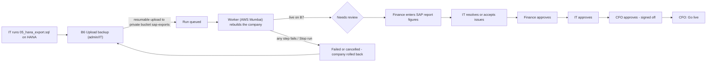

# Process flow · SAP migration, company by company

| # | Who | Where | What happens |
|---|---|---|---|
| 1 | IT (SAP team) | HANA | Run `05_hana_export.sql` (download it on B6 with the schema filled in): queries 1, 2, 4 as CSV + the EXPORT step |
| 2 | Admin / IT | B6 Upload backup | Choose the export folder or .zip. Upload continues after a dropped connection or closed tab. The checklist shows what is missing |
| 3 | Admin / IT | B6 | **Start load and rebuild** (opens when the data folder, columns.csv and row_counts.csv are in) |
| 4 | Worker | B7 Rebuild run | 12 steps, live: check files → read → copy into the SAP copy → clean → orphans → links → keys → lock → app tables → checks → cross-check. Other companies keep working. Failure or Stop = the company goes back exactly as it was |
| 5 | Finance (Chief Accountant) | Approvals → B8 | Enter the 8 figures printed from SAP (trial balance groups, open A/R, open A/P, stock value). A figure > 0.01 away blocks sign-off |
| 6 | Admin / IT | B8 | Accept (with a note) or fix every critical issue |
| 7 | Finance, IT, CFO | B8 | Each approves their own role. Locked while a critical issue is open |
| 8 | CFO | B8 | **Go live** - recorded in the audit log, only once per company |

Field-list only uploads (Excel "Table Name / Field Name / Data Type…") go through steps 2 and 4 as a **structure check**: no data is touched, the result shows on B6.

## Tested live on 8–9 Nov 2026 (sample data `supabase/tests/testexp/AE01`)
- Structure check with 9 Excel field lists built from the real schema: 3,262 tables, 3,250 matched, 12 left out, 0 missing, 0 type differences, AUG1 repaired.
- Full load: 62 files uploaded on the live site → Checking files → Loading → Rebuilding → Cross-checking → Needs review in ~5 minutes; 3,657 links validated, 151 checks, 0 failed, 8 warnings (SAP report figures not entered yet - by design).
- Finance entered the 8 figures (warnings closed), Finance / IT / CFO approved from their own logins, CFO took AE01 live; 20 audit entries.
- Afterwards the test go-live was **reset** (logged as `company_go_live_reset`) and the test runs are labelled "TEST RUN", so the real AE01 export can go live.
- With `max_locks_per_transaction` = 64 the rebuild failed safely and rolled back; it is now 2048 (37,757 locks used by the test run).
